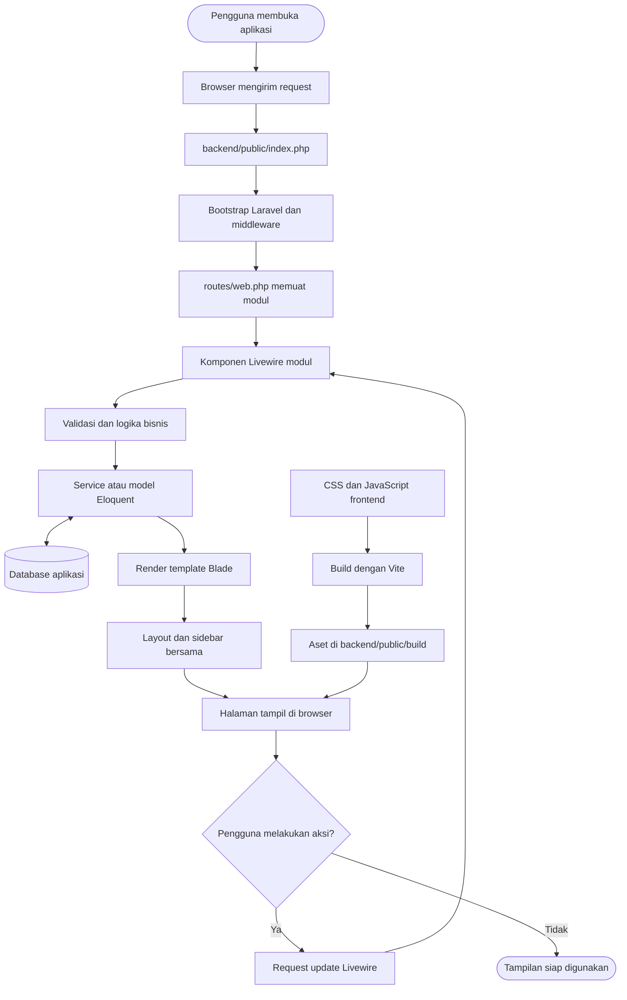
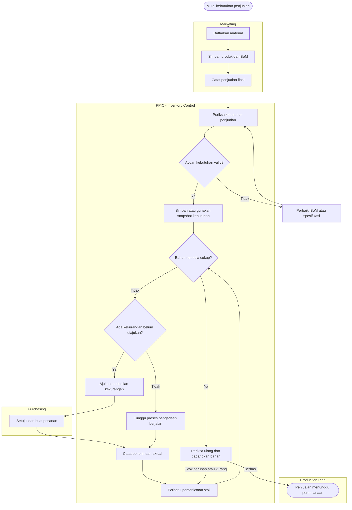
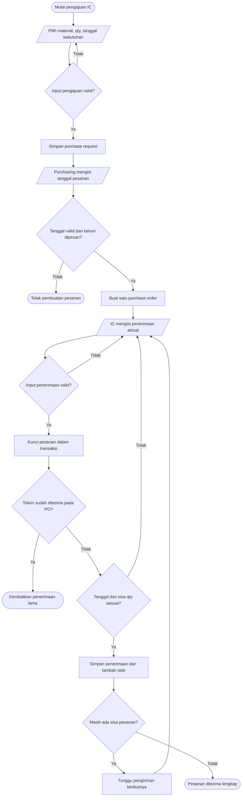
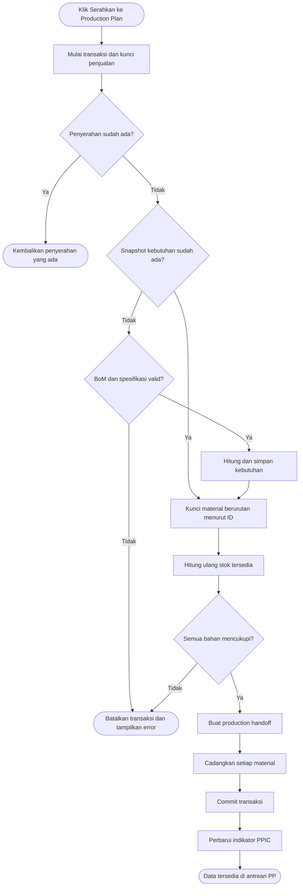
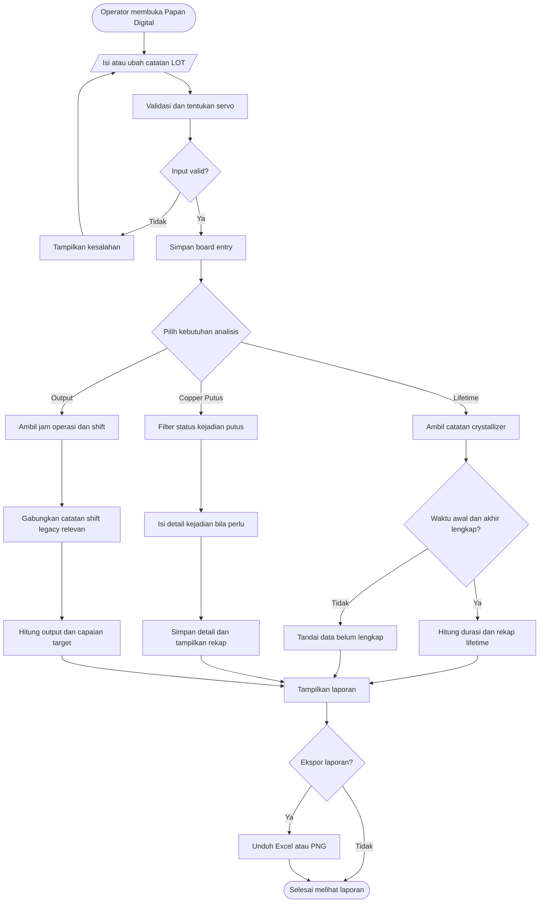
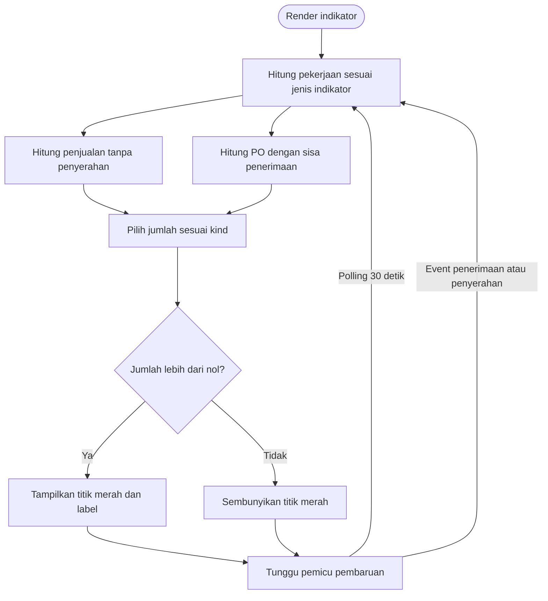
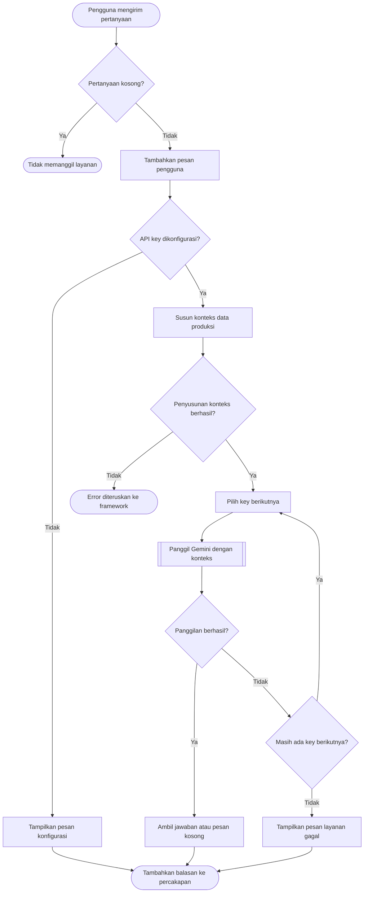
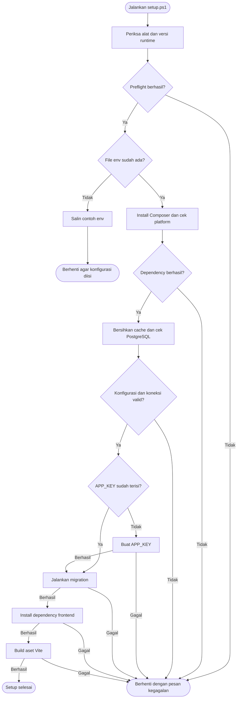

# Analisis dan Flowchart irris.next

Tanggal analisis: 28 Oktober 2026. Disusun menggunakan skill Flowchart Maker berdasarkan source code pada checkout lokal.

## Cakupan dan kesimpulan

Pemetaan mencakup struktur proyek, konfigurasi, route, komponen Livewire, service bisnis, model, migration, template Blade, aset frontend, setup, dan daftar pengujian. Folder dependency (`vendor`, `node_modules`), hasil build/cache, riwayat `.git`, dan data runtime diperlakukan sebagai infrastruktur, bukan kode bisnis yang dianalisis satu per satu. Isi `.env` lokal dan database operasional tidak dibaca.

Arsitekturnya adalah **monolit Laravel modular** dengan empat modul bisnis. Folder `frontend` menyimpan sumber tampilan yang tetap dirender oleh Laravel di `backend`; bukan aplikasi SPA terpisah dengan REST API sendiri. `composer.json` mendeklarasikan Laravel 12 dan Livewire 3; `package.json` mendeklarasikan Vite 6 dan SheetJS (`xlsx`). PostgreSQL merupakan konfigurasi instalasi pada `.env.example` dan `setup.ps1`; pengujian memakai SQLite in-memory.

Alur bisnis yang sudah tersambung: **katalog → penjualan → pemeriksaan kebutuhan bahan → pengadaan jika kurang → penerimaan → pencadangan bahan → antrean Production Plan**. Modul Produksi sudah berjalan untuk pencatatan Copper Rod, tetapi belum memiliki hubungan transaksi dengan penyerahan Production Plan.

Diagram menggambarkan implementasi saat ini. Panah proses menunjukkan urutan tindakan, bukan berarti semua tindakan berjalan otomatis. Langkah pengguna seperti persetujuan, penerimaan, dan penyerahan tetap dipicu melalui UI.

## Peta folder

| Folder/file | Tanggung jawab |
| --- | --- |
| `README.md` | Petunjuk fitur, instalasi, operasi, dan pengembangan |
| `setup.ps1` | Pemeriksaan lingkungan, dependency, koneksi database, migration, dan build |
| `backend/app/Modules/Marketing` | Katalog produk, BoM, master material, dan penjualan; 7 file PHP |
| `backend/app/Modules/Ppic` | Kebutuhan bahan, pengajuan, penerimaan, reservasi, indikator, dan antrean PP; 13 file PHP |
| `backend/app/Modules/Purchasing` | Persetujuan dan pesanan pembelian; 4 file PHP |
| `backend/app/Modules/Produksi` | Papan Digital, Crystallizer, Copper Putus, Rekap Output, Sino; 16 file PHP |
| `backend/app/Models` | Model `User`; tidak membuktikan login sudah diimplementasikan |
| `backend/app/Providers` | Registrasi alias komponen Livewire lintas modul |
| `backend/bootstrap` | Bootstrap aplikasi, provider, dan cache framework |
| `backend/config` | Database, tampilan, session, cache, queue, dan konfigurasi framework |
| `backend/database/migrations` | 7 migration yang membuat 13 tabel bisnis |
| `backend/database/seeders` | Seeder kosong; tidak mengisi data operasional |
| `backend/database/factories` | Placeholder factory |
| `backend/routes` | Memuat route keempat modul dan route console |
| `backend/public` | Entry HTTP `index.php`, logo/gambar, dan keluaran build |
| `backend/storage` | Log, session, cache, dan compiled view saat runtime |
| `backend/tests` | 6 kelas feature test; direktori unit masih placeholder |
| `backend/vendor` | Dependency Composer |
| `frontend/resources/views/components` | Layout, sidebar, ikon, pagination, dan tampilan error bersama |
| `frontend/resources/views/modules` | Blade untuk Produksi, PPIC, Marketing, dan Purchasing |
| `frontend/resources/css` | Tema, palet, gaya dasar, dan gaya tiap modul |
| `frontend/resources/js` | Entry JS, event Livewire, scroll, ekspor Excel dan PNG |
| `frontend/vite.config.js` | Menghubungkan input frontend dengan public directory backend |
| `frontend/node_modules`, `frontend/.vite` | Dependency JavaScript dan cache tooling |
| `.git`, `.gitignore` | Riwayat versi dan aturan pengecualian file lokal |

JavaScript PPIC, Marketing, dan Purchasing saat ini berupa placeholder; interaksi utamanya ditangani Livewire. Alpine dipakai pada layout, antara lain untuk notifikasi. Ekspor Produksi memakai SheetJS untuk Excel dan Canvas untuk PNG di browser.

## 1. Arsitektur dan siklus request



1. Laravel menerima request dan memilih komponen berdasarkan route modul.
2. Komponen menjalankan validasi, service, dan/atau query Eloquent. Sebagian logika, seperti katalog dan penyimpanan papan, berada langsung di komponen.
3. `config/view.php` menunjuk ke `../frontend/resources/views`. Layout memuat aset Vite dan skrip Livewire.
4. Aksi form mengirim update Livewire. Alias komponen didaftarkan di `AppServiceProvider` agar tetap dikenali pada request berikutnya.

Sumber: [bootstrap](../backend/bootstrap/app.php), [route utama](../backend/routes/web.php), [provider](../backend/app/Providers/AppServiceProvider.php), [konfigurasi view](../backend/config/view.php), [Vite](../frontend/vite.config.js).

## 2. Alur utama Marketing, IC, Purchasing, dan PP



1. Marketing mendaftarkan material, produk Copper Rod beserta BoM, lalu penjualan final satu produk per transaksi.
2. Nama, diameter, dan kemurnian produk disalin ke penjualan. Pencatatan penjualan belum mengurangi stok.
3. Saat pemeriksaan IC pertama, BoM harus berisi bahan dan hasil acuan positif; diameter serta kemurnian katalog harus cocok dengan penjualan. Kebutuhan yang berhasil dihitung disimpan sebagai snapshot. Pemeriksaan berikutnya memakai snapshot tersebut, bukan menghitung ulang resep katalog terbaru.
4. Bila bahan kurang, IC hanya mengajukan bagian kekurangan yang belum tercakup pengajuan berjalan untuk penjualan dan material yang sama. Pengajuan manual juga tersedia melalui tab Pengajuan Pembelian dan tidak harus terkait penjualan.
5. Purchasing menyetujui pengajuan menjadi pesanan. IC mencatat penerimaan aktual, termasuk penerimaan sebagian, lalu memeriksa ulang stok.
6. Bila semua bahan cukup, proses penyerahan memeriksa ulang dan mencadangkan bahan dalam transaksi. Antrean PP menampilkan status **Menunggu perencanaan**.

Rumus sesuai `SalesReadinessService`:

```text
kebutuhan = ceil_3_desimal(qty bahan BoM × qty penjualan / hasil acuan BoM)
stok fisik tercatat = total inventory_receipts.quantity untuk material
tersedia untuk SO = max(0, stok fisik - seluruh reservasi + reservasi SO sendiri)
kekurangan = max(0, kebutuhan - tersedia untuk SO)
pengajuan berjalan = jumlah sisa pengajuan SO-material setelah penerimaan
perlu diajukan = max(0, kekurangan - pengajuan berjalan)
```

Pengajuan/PO belum dianggap stok. Cadangan milik sendiri ditambahkan kembali ketika melihat penjualan yang sudah diserahkan; stok bebas global tetap stok fisik dikurangi seluruh reservasi.

Sumber: [master barang](../backend/app/Modules/MasterData/Models/Item.php), [penjualan](../backend/app/Modules/Marketing/Services/SalesService.php), [kesiapan bahan](../backend/app/Modules/Ppic/Services/SalesReadinessService.php), [antrean PP](../backend/app/Modules/Ppic/Livewire/ProductionPlanPage.php).

## 3. Pengadaan dan penerimaan barang



1. Master barang harus sudah ada. Nama dan satuan diambil dari master, bukan input bebas pada pengajuan.
2. Satu pengajuan hanya dapat memiliki satu PO. Tanggal pembelian tidak boleh di masa depan; estimasi kedatangan tidak boleh sebelum pembelian.
3. Penerimaan memerlukan qty positif, maksimal tiga desimal, tanggal valid, dan UUID token.
4. Token penerimaan yang sama pada PO mengembalikan penerimaan sebelumnya. Penerimaan baru tidak boleh mendahului tanggal pembelian atau melebihi sisa pesanan.
5. Status PO dihitung dari sisa qty: Menunggu barang, Diterima sebagian, atau Diterima lengkap. Tidak terdapat cabang bisnis penolakan/pembatalan pengajuan yang tersimpan pada implementasi ini.

Sumber: [ProcurementService](../backend/app/Modules/Purchasing/Services/ProcurementService.php), [PurchaseOrder](../backend/app/Modules/Purchasing/Models/PurchaseOrder.php).

## 4. Penyerahan ke Production Plan



1. Penyerahan berulang mengembalikan record yang sama.
2. Penguncian material dengan urutan konsisten dimaksudkan agar dua penjualan tidak mencadangkan stok bebas yang sama pada saat bersamaan.
3. Kegagalan validasi/kecukupan menggagalkan transaksi; penyerahan dan reservasi dibuat bersama ketika pemeriksaan berhasil.
4. Reservasi mengurangi stok tersedia, tetapi belum menjadi pengeluaran fisik. Tidak ada mekanisme pelepasan reservasi pada jalur yang tersedia saat ini.

Sumber: [SalesReadinessService::handOver](../backend/app/Modules/Ppic/Services/SalesReadinessService.php), [migration kesiapan IC](../backend/database/migrations/2026_10_27_000007_create_ic_sales_readiness_tables.php).

## 5. Pencatatan dan analitik Produksi Copper Rod



1. Input jam operasi memerlukan shift dan servo yang dapat ditentukan. Servo diambil dari kode Take Up/Cooling; pilihan manual menjadi fallback bila kode tidak memberikan servo. Konflik kode tidak diselesaikan dengan menimpa pilihan manual.
2. Papan menyimpan tanggal, LOT, peralatan, waktu upcasting/pickup, berat, jam operasi, status kejadian, dan catatan.
3. Crystallizer menghitung lifetime dari waktu upcasting sampai pickup aktual. Jam operasi shift tidak digunakan sebagai pengganti lifetime.
4. Copper Putus menggunakan board berstatus `putus` atau `putus_tarik_lot_baru`; detail tambahan berisi supervisor, kategori, kejadian, frekuensi, dan catatan.
5. Rekap Output memakai jam operasi board serta shift legacy yang belum terwakili. Baris board dengan servo tidak terklasifikasi dilewati dan dihitung sebagai baris terlewat.
6. Output per shift dihitung sebagai `0.04293 × (jam Servo X + jam Servo Y)` MT. Ini hasil perhitungan dari jam operasi, bukan penjumlahan berat aktual LOT. Target default kode adalah 10.368 MT/hari.
7. Ekspor dikirim sebagai event Livewire; browser membuat file Excel/PNG.

Diagram ini berdiri sendiri dari diagram penjualan. Belum ada `sales_order_id`, `handoff_id`, atau work order penghubung pada `board_entries`.

Sumber: [BoardPage](../backend/app/Modules/Produksi/Livewire/BoardPage.php), [servo](../backend/app/Modules/Produksi/Services/ServoInferenceService.php), [Crystallizer](../backend/app/Modules/Produksi/Services/CrystallizerAnalyticsService.php), [Copper Putus](../backend/app/Modules/Produksi/Services/CopperBreakService.php), [Output](../backend/app/Modules/Produksi/Services/OutputSummaryService.php), [ekspor](../frontend/resources/js/modules/produksi/export-report.js).

## 6. Indikator perhatian PPIC



1. `kind=sales` menghitung penjualan yang belum memiliki `productionHandoff`.
2. `kind=incoming` menghitung PO yang total penerimaannya lebih kecil daripada qty pengajuan.
3. `kind=inventory` menjumlahkan kedua kelompok. Query kelompok yang tidak diperlukan dilewati pada masing-masing jenis spesifik.
4. Memeriksa kebutuhan saja belum memadamkan indikator penjualan. Penerimaan parsial juga belum memadamkan indikator PO.
5. Komponen kecil ini melakukan polling dan mendengarkan `ppic-attention-updated`, sehingga form induk tidak ikut dimuat ulang oleh indikator. Persetujuan PO tidak mengirim event ini pada komponen Purchasing; pembaruannya dapat tertangkap polling/render berikutnya.

Sumber: [AttentionIndicator](../backend/app/Modules/Ppic/Livewire/AttentionIndicator.php), [PpicAttentionService](../backend/app/Modules/Ppic/Services/PpicAttentionService.php), [Blade indikator](../frontend/resources/views/modules/ppic/livewire/attention-indicator.blade.php).

## 7. Sino dan layanan AI eksternal



1. Konteks terdiri atas jumlah/rentang data board, 30 catatan board terbaru, hingga 15 ringkasan crystallizer, dan hingga 20 kejadian Copper Putus terbaru.
2. Service mengirim pertanyaan saat ini dan konteks tersebut ke Gemini. Riwayat chat yang tampil di UI tidak dikirim sebagai percakapan lengkap.
3. Panggilan HTTP memakai timeout 35 detik per key. Kegagalan panggilan mencoba key berikutnya; penyusunan konteks berada di luar blok penanganan kegagalan HTTP.
4. Jalur Sino membaca data dan mengembalikan jawaban; tidak terdapat operasi penulisan transaksi bisnis melalui AI pada service ini.

Sumber: [SinoChat](../backend/app/Modules/Produksi/Livewire/SinoChat.php), [SinoAiService](../backend/app/Modules/Produksi/Services/SinoAiService.php). Integrasi eksternal hanya dipetakan dari kode, tidak dipanggil saat analisis.

## 8. Setup proyek



1. Script memeriksa PHP minimal 8.4.1, driver `pdo_pgsql`, Composer, Node, dan npm.
2. Jika `.env` belum ada, script membuat salinannya lalu berhenti. Database harus dibuat terlebih dahulu di PostgreSQL.
3. APP_KEY yang sudah ada dipertahankan. Migration dijalankan setelah koneksi diverifikasi.
4. Semua hasil akhir melewati `finally` untuk mengembalikan lokasi terminal. Setelah setup, aplikasi dijalankan melalui Laravel/Herd; Vite melayani aset pengembangan bila diperlukan.

Sumber: [setup.ps1](../setup.ps1), [panduan proyek](../README.md).

## Peta data dan hubungan modul

| Tabel | Peran dan hubungan |
| --- | --- |
| `inventory_products` | Master material bersama Marketing, IC, dan Purchasing; nama/satuan dinormalisasi melalui identity key |
| `marketing_products` | Katalog spesifikasi produk jadi dan hasil acuan BoM |
| `marketing_bom_items` | Menghubungkan produk katalog dengan material dan qty resep |
| `marketing_sales_orders` | Penjualan final, snapshot spesifikasi, pelanggan, qty, dan tenggat kirim |
| `ic_sale_material_requirements` | Snapshot kebutuhan tiap material per penjualan |
| `purchase_requests` | Pengajuan material; hubungan ke penjualan bersifat opsional |
| `purchase_orders` | Maksimal satu pesanan per pengajuan |
| `inventory_receipts` | Banyak penerimaan per pesanan; sumber saldo fisik tercatat |
| `production_handoffs` | Maksimal satu penyerahan per penjualan |
| `production_material_reservations` | Qty dicadangkan per penyerahan dan material |
| `board_entries` | Catatan produksi LOT; belum terhubung ke penjualan/penyerahan |
| `shift_entries` | Jam shift legacy; referensi board opsional |
| `copper_break_entries` | Detail kejadian putus; referensi board opsional dan unik |

Relasi board pada `shift_entries` dan `copper_break_entries` tersedia di model/kolom, tetapi migration tidak mendefinisikan foreign key database untuk kedua kolom tersebut. Jalur hapus board menghapus detail putus dan melepas referensi shift secara eksplisit.

## Peta halaman

| URL | Komponen atau hasil |
| --- | --- |
| `/` | Produksi / `BoardPage` |
| `/crystallizer` | Produksi / `CrystallizerPage` |
| `/copper-break` | Produksi / `CopperBreakPage` |
| `/output` | Produksi / `OutputPage` |
| `/ppic` | PPIC / dashboard placeholder |
| `/ppic/inventory-control` | IC: penjualan, pengajuan, barang masuk, barang keluar, stok |
| `/ppic/production-plan` | Antrean penyerahan dari IC |
| `/marketing` | Redirect ke `/marketing/sales` |
| `/marketing/products` | Redirect ke `/marketing/sales` (URL katalog lama) |
| `/marketing/sales` | Penjualan final |
| `/purchasing` | Pengajuan menunggu diproses dan daftar PO |
| `/up` | Health route dari bootstrap Laravel |

Katalog Material merupakan tab dalam halaman katalog, bukan route terpisah. Update Livewire ditangani framework; folder route proyek tidak menyediakan REST API bisnis terpisah.

## Temuan dan batas implementasi

| Temuan | Dampak pada pembacaan flowchart | Dasar kode |
| --- | --- | --- |
| Production Plan baru menampilkan antrean | Jangan menggambar penjadwalan mesin atau pembuatan work order sebagai fitur aktif | `ProductionPlanPage` hanya memuat daftar handoff |
| Barang Keluar masih placeholder | Belum ada konsumsi fisik bahan, koreksi stok keluar, atau pelepasan reservasi | Blade IC dan service stok/pengadaan |
| Produksi belum terhubung ke penjualan | LOT belum dapat dilacak otomatis ke SO dari relasi yang tersedia | Migration board tidak memiliki referensi SO/handoff |
| Pengiriman pelanggan belum dicatat | `ship_by` adalah tenggat, bukan bukti pengiriman atau pemotongan stok | `SalesService` dan migration penjualan |
| Auth/otorisasi modul belum tampak pada route aplikasi | Nama departemen pada diagram menunjukkan pembagian proses, belum pembatasan akses per peran | Route modul tanpa middleware `auth`/role; label pengguna pada layout bersifat tampilan |
| Formula output memakai jam operasi | Rekap MT tidak identik dengan total berat aktual LOT | `OutputSummaryService` |
| Label sumber Sino masih menyebut SQLite | Label balasan tidak mencerminkan target PostgreSQL pada panduan setup | `SinoAiService::callGeminiWithContext` |
| Database default config masih fallback SQLite | Konfigurasi env diperlukan agar deployment memakai PostgreSQL sesuai setup | `config/database.php`, `.env.example`, `setup.ps1` |
| Konteks Sino dibatasi jumlah record | Jawaban AI tidak otomatis merupakan analisis seluruh histori | `SinoAiService::buildSystemPrompt` |

Tabel ini mendeskripsikan kondisi kode, bukan hasil audit keamanan atau pembuktian perilaku deployment. Kandidat pengembangan berikutnya adalah penghubung handoff → work order/LOT, pencatatan barang keluar dan pelepasan reservasi, pengiriman, serta pembatasan akses sesuai peran.

## Verifikasi analisis

- Alur utama dicocokkan dengan service, komponen, model, migration, dan Blade yang terkait.
- Enam kelas feature test mencakup rendering/navigasi, katalog, penjualan, pengadaan, kesiapan penjualan, dan indikator PPIC. Terdapat 35 metode `test_` pada snapshot yang diperiksa.
- Skenario uji yang tersedia mencakup penerimaan parsial, token penerimaan/penjualan berulang, kelebihan penerimaan, snapshot kebutuhan, reservasi antarpenjualan, dan indikator yang bertahan sampai pekerjaan selesai.
- Test suite tidak dijalankan pada analisis ini; perintah `php` tidak ditemukan di PATH terminal saat pemeriksaan. Ketersediaan tes tidak disamakan dengan hasil tes lulus.
- Flowchart diperiksa secara struktural terhadap cabang kode. Dokumen memakai Mermaid; tampilan visual memerlukan preview Markdown yang mendukung Mermaid. Tidak ada klaim render grafis telah diuji.
- Analisis tidak mengubah source aplikasi atau data operasional.

File `.mmd` di folder [flowcharts](flowcharts/) berisi diagram terpisah yang dapat diedit atau diimpor ke tool yang mendukung Mermaid.
